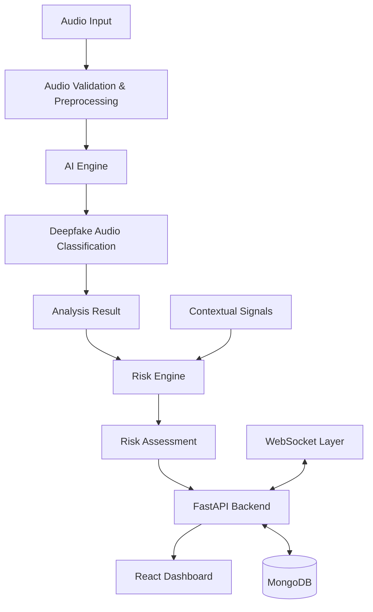

🛡️ VoiceShield AI
AI-Powered Voice Deepfake Detection & Fraud Risk Analysis
Detect suspicious synthetic voices. Assess risk. Strengthen voice security.

  
  
  
  
  
  
  

  <a href="https://github.com/vaibhav708378/VoiceShield-AI">Repository</a> •
  <a href="#-overview">Overview</a> •
  <a href="#-architecture">Architecture</a> •
  <a href="#-technology-stack">Tech Stack</a> •
  <a href="#-getting-started">Getting Started</a> •
  <a href="#-roadmap">Roadmap</a>

📌 Overview
VoiceShield AI is an AI-driven voice security project developed for Smart India Hackathon 2026 – Problem Statement SIH26104.

With the increasing accessibility of generative AI and voice-cloning technologies, attackers can create synthetic speech that imitates real people. Such audio can potentially be misused in impersonation, social engineering, and voice-based fraud.

VoiceShield AI explores a layered approach to identifying suspicious audio and supporting safer voice interactions. It combines audio preprocessing, deepfake classification, risk analysis, backend services, and a web-based interface.

The project is being developed as a modular system so that AI inference, application services, real-time communication, and security logic can evolve independently.
Project status: Under active development. The candidate deepfake classification model has been downloaded and loaded successfully. End-to-end inference on validated audio, model evaluation, and complete integration are still in progress. Model outputs must not be treated as verified proof that a voice is genuine or cloned.

🎯 Problem Statement
AI-generated speech and voice cloning introduce new risks to digital communication.

Traditional call-screening methods often rely on phone numbers, known spam patterns, or user reports. They may not identify a suspicious call when an attacker uses a newly generated or impersonated voice.

VoiceShield AI explores how audio-based machine learning and contextual risk signals can help identify potentially manipulated or suspicious speech.
💡 Project Objectives
- Explore detection of AI-generated and manipulated voice recordings.
- Build an audio preprocessing pipeline for consistent model input.
- Integrate a pretrained audio-classification model.
- Develop a modular backend for audio analysis and application services.
- Explore consent-based speaker verification as a separate capability.
- Design a risk engine to combine available detection and contextual signals.
- Provide a React dashboard for interacting with the system.
- Apply privacy-conscious handling of audio, credentials, and speaker data.
⚙️ Key Modules
Module	Responsibility
AI Engine	Audio classification and model inference
Audio Preprocessing	Audio validation, loading, and preparation
Backend API	FastAPI endpoints, authentication, and application services
Risk Engine	Risk assessment using available analysis signals
Realtime Module	WebSocket communication and real-time processing foundation
Frontend	React-based user interface and dashboard
Security	Authentication, configuration, and privacy-conscious data handling
Documentation	Architecture, development notes, and project documentation

The modules represent the project's architecture. Their presence does not imply that every capability is fully implemented or validated.
🏗️ System Architecture

Processing Workflow
1. Audio Input — A user provides an audio sample through the application.
2. Validation — The backend checks whether the submitted audio can be processed.
3. Preprocessing — Audio is prepared for the model's expected input format.
4. AI Analysis — The candidate audio-classification model evaluates the recording.
5. Risk Assessment — Available analysis signals can be combined with contextual information.
6. API Response — The backend returns structured results to the client.
7. Dashboard — The frontend presents the available result and relevant safety information.
The architecture is modular and the end-to-end workflow is still being integrated and tested.
🤖 AI Model
Current Candidate Model
Property	Details
Model	Vansh180/deepfake-audio-wav2vec2
Model source	Hugging Face
Task	Audio classification
Reported labels	real, fake
Framework	PyTorch
Model integration	Hugging Face Transformers
Audio handling	SoundFile and NumPy
Runtime target	CPU inference configured in the development environment

The model has been downloaded and loaded successfully in the development environment. A valid audio sample and a repeatable evaluation process are still required to verify end-to-end predictions.
Important Model Notes
- Model labels and raw scores are not automatically calibrated probabilities.
- Model loading does not establish detection accuracy.
- Performance must be evaluated using labelled genuine and synthetic recordings.
- False-positive and false-negative rates must be measured.
- Speaker verification and scam-intent detection are separate tasks; they are not provided by the current real/fake audio classifier.
- Empty placeholder checkpoint files are not trained model weights.
🧰 Technology Stack
Layer	Technologies
Programming Language	Python, JavaScript
AI / Deep Learning	PyTorch, Hugging Face Transformers
Audio Processing	SoundFile, NumPy
Backend	FastAPI, Uvicorn
Frontend	React, Vite
Database	MongoDB
Real-time Communication	WebSocket
Development Tools	VS Code, Git, GitHub
API Documentation	FastAPI Swagger UI

📁 Repository Structure
VoiceShield-AI/
│
├── .vscode/
│
├── VoiceShield-AI/          # Nested project directory
│
├── ai-engine/
│   ├── checkpoints/
│   ├── configs/
│   ├── datasets/
│   ├── features/
│   ├── inference/
│   │   ├── predict.py
│   │   └── test_deepfake_model.py
│   ├── models/
│   │   ├── deepfake_detector/
│   │   └── scam_detection/
│   ├── preprocessing/
│   ├── tests/
│   ├── training/
│   └── requirements.txt
│
├── backend/
│   └── app/
│       ├── core/
│       ├── database/
│       ├── realtime/
│       ├── routes/
│       └── services/
│
├── deployment/
├── docs/
├── frontend/
│   └── src/
├── realtime/
├── risk-engine/
├── scripts/
├── security/
│
├── .env.example
├── .gitignore
├── docker-compose.yml
└── README.md
This is a high-level view of the repository. Some folders may be expanded as development continues.
🚀 Getting Started
Prerequisites
Install the following before running the project:
- Python 3.13
- Node.js and npm
- MongoDB Community Server or an accessible MongoDB instance
- Git
- VS Code or another suitable IDE
- Internet access for the initial model download
1. Clone the Repository
git clone https://github.com/vaibhav708378/VoiceShield-AI.git
2. Navigate to the Project
cd VoiceShield-AI
Run commands from the outer repository directory unless a step explicitly says otherwise.
3. Configure Environment Variables
Create or update backend/.env:
MONGODB_URL=mongodb://localhost:27017
DATABASE_NAME=voiceshield_ai
SECRET_KEY=replace-with-a-long-random-secret
Use a strong, unique secret in your local environment. Never commit .env files, passwords, API keys, tokens, or production credentials.
4. Set Up the Python Environment
python -m venv .venv
Activate it on Windows PowerShell:
.\.venv\Scripts\Activate.ps1
Install AI engine dependencies:
python -m pip install -r .\ai-engine\requirements.txt
PyTorch is also required by the current model integration. Install a compatible build for your operating system and hardware using the official PyTorch installation guide.

If a backend requirements file is available and populated, install it:
python -m pip install -r .\backend\requirements.txt
If it is not available or is incomplete, install the backend dependencies specified by the project before starting the server.
5. Set Up the Frontend
Open a separate terminal:
cd frontend
npm install
▶️ Running the Application
Run the backend and frontend in separate terminals.
Terminal 1 — Backend
From the repository root:
cd backend
python -m uvicorn app.main:app --reload
Backend:
http://127.0.0.1:8000
Interactive API documentation:
http://127.0.0.1:8000/docs
Alternative API documentation:
http://127.0.0.1:8000/redoc
Terminal 2 — Frontend
cd frontend
npm run dev
Open the local Vite URL displayed in the terminal, commonly:
http://localhost:5173
The frontend's API and WebSocket functionality requires the backend to be running and correctly configured.
🧪 Testing the AI Model
1. Check Model Loading
From the repository root:
python .\ai-engine\inference\test_deepfake_model.py
2. Run Prediction on an Audio File
Provide the path to an existing audio recording:
python .\ai-engine\inference\predict.py "D:\path\to\your\recording.wav"
Use recordings that you own or have permission to analyze. The supplied file must exist and meet the input requirements of the inference pipeline.
3. Validate Model Performance
Before relying on predictions, evaluate the model using a labelled dataset containing both genuine and synthetic speech.

Recommended evaluation metrics:
- Accuracy
- Precision
- Recall
- F1-score
- Confusion matrix
- False-positive rate
- False-negative rate
- Inference latency
🔐 Privacy & Security Principles
Voice data is sensitive. VoiceShield AI is being developed with the following principles in mind:
- Obtain informed consent before recording or analyzing someone's voice.
- Avoid retaining raw audio unless necessary and explicitly authorized.
- Protect authentication tokens, database credentials, and speaker-related data.
- Define clear retention and deletion policies.
- Restrict access to recordings and analysis results.
- Validate uploaded audio and apply suitable size and format limits.
- Keep secrets in environment variables, not source code.
- Treat automated detection as decision support, not a final accusation.
🗺️ Roadmap
The following roadmap separates completed development milestones from work that still needs implementation or validation.
Area	Current status
Project architecture and module structure	
Candidate Wav2Vec2 model download and loading	
End-to-end inference on validated audio	
Model benchmarking and evaluation	
FastAPI application and authentication foundation	
MongoDB integration and data lifecycle	
React dashboard integration	
End-to-end WebSocket audio processing	
Consent-based speaker verification	
Scam-intent analysis	
Explainable risk assessment	
Security, privacy, and performance testing	

Next Development Priorities
1. Run inference on valid genuine and synthetic audio samples.
2. Build a reproducible labelled evaluation dataset.
3. Measure model performance and document limitations.
4. Integrate validated inference into the backend audio service.
5. Connect the frontend to the backend analysis workflow.
6. Implement and test real-time audio processing.
7. Develop speaker verification as a separate consent-based feature.
8. Add contextual scam-intent analysis and explainable risk scoring.
9. Complete privacy, security, and robustness testing.
🤝 Contributing
This repository is part of an ongoing development project. Contributions, suggestions, and constructive feedback are welcome.
1. Fork the repository.
2. Create a feature branch.
3. Make focused changes and add appropriate tests.
4. Commit your changes with a clear message.
5. Open a pull request describing the changes.
Please do not include private recordings, credentials, model secrets, or personal information in commits.
👨‍💻 Project
VoiceShield AI
Smart India Hackathon 2026 — Problem Statement SIH26104

Developer: Vaibhav Patil
- GitHub: github.com/vaibhav708378
- LinkedIn: linkedin.com/in/vaibhav708378
- Portfolio: vaibhavpatil70.vercel.app
⚠️ Disclaimer
VoiceShield AI is an experimental development project. Audio-classification results can be incorrect and may vary across speakers, languages, recording devices, codecs, and environmental conditions.

A model prediction is not proof of identity, fraud, or malicious intent. Do not use an unvalidated result as the sole basis for financial, legal, employment, or other high-impact decisions.

🛡️ Detect. Analyze. Protect.
Building safer voice interactions through responsible AI.

⭐ If you find this project interesting, consider giving the repository a star.

